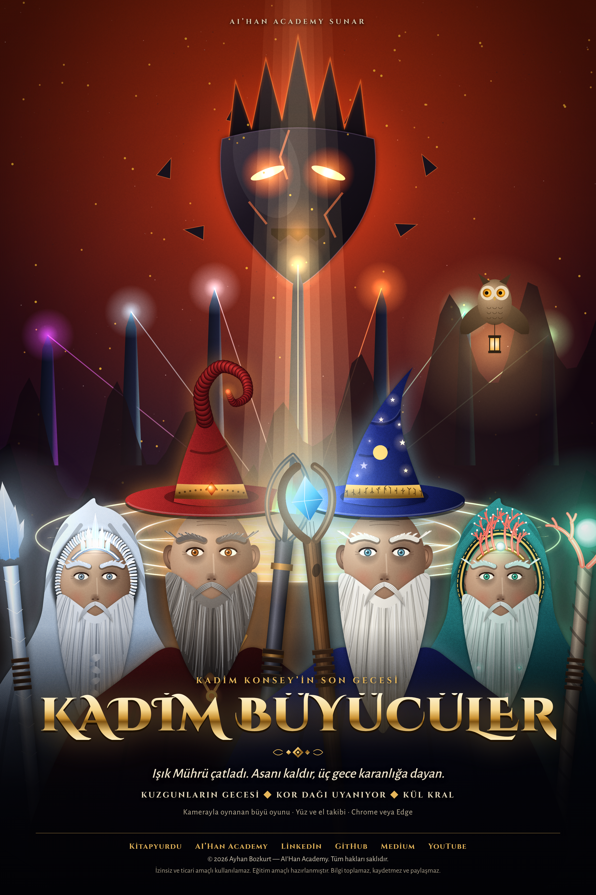

# Kadim Büyücüler · Asa ve Kalkan

**[Türkçe](#türkçe) · [English](#english)**

---

## Türkçe

### Oyun hakkında

**Kadim Büyücüler**, kamerayla oynanan sinematik bir büyü oyunu. Yüz takibi yüzüne büyücünün başlığını, sakalını ve cübbesini giydirir. El takibi ise asayı gerçekten yumruğunda tutuyormuş gibi gösterir. Kül Kral'ın yaratıklarına karşı asanı yere vurur, büyü okları fırlatır ve Kadim Büyü'yü ağzını açarak serbest bırakırsın.

Oyun tek bir HTML dosyasıdır. Kurulum ve derleme gerektirmez.

### Hikâye

Kadim Diyar'da yedi kule, yedi büyücüyü gökyüzüne bağlardı. Kulelerin ışığı, karanlığı yerin altında tutan **Işık Mührü**'nü bin yıl boyunca besledi. Konseyin yedinci üyesi **Gölge Bilge Karan** ölümsüzlük vaadine kandı ve mührü çatlattı. Çatlaktan **Kül Kral** sızdı. **Başbilge Aydın** mührü tutabilmek için kendini taşın içine hapsetti.

Konseyden geriye dört genç büyücü kaldı. Amacın üç gece dayanmak, üç bekçiyi yenmek, mührü yenilemek ve Başbilge Aydın'ı kurtarmak.

### Kadim Konsey

| Büyücü | Rolü | Kadim Büyü |
|---|---|---|
| Yıldız Gözcüsü | Oynanabilir · dengeli | Yıldız Yağmuru: gökten düşen yıldızlar düşmanları tek tek vurur |
| Ayaz Bilgesi | Oynanabilir · en uzun kalkan | Ebedi Ayaz: düşmanları beş saniye dondurur, donmuş düşman iki kat hasar alır |
| Kor Ustası | Oynanabilir · en ucuz ok | Kor Tufanı: yüzünden yayılan ateş halkası yolundaki her şeyi yakar |
| Gelgit Kâhini | Oynanabilir · en hızlı mana | Büyük Dalga: ekranı baştan sona süpüren dev bir dalga |
| Başbilge Aydın | Taşta mühürlü · rehber | — |
| Şifacı Melis | Fener Baykuşu'nu gönderir | — |
| Gölge Bilge Karan | Hain | — |

### Üç gece

| Gece | Bekçi | Davranışı |
|---|---|---|
| Kuzgunların Gecesi | Kuzgun Ana | Hedefini kırmızı çizgiyle gösterip dalar. Kalkana çarparsa sersemler. |
| Kor Dağı Uyanıyor | Kor Dev | Aşağıdan yükselir, kaya fırlatır. |
| Kül Kral | Kül Kral | Ateş topu atar. Canı yarıya inince öfkelenir ve yardımcı çağırır. |

Her gece üç dalga ve bir bekçiyle biter. Üç bekçiyi de yenersen final sahnesi oynar ve dilersen **Sonsuz Gece** moduna geçersin.

### Kontroller

| Hareket | Etkisi | Klavye |
|---|---|---|
| Yumruğunu kapatıp kaldır | Asa avucuna oturur | — |
| Yumruğunu hızla indirip durdur | Şok dalgası ve kalkan (30 mana) | Boşluk |
| Yumruğunu bir anda aç | Büyü oku | B |
| Ağzını kocaman aç (bar doluyken) | Kadim Büyü | U |
| Asanın kristalini baykuşa değdir | Can ve mana | — |
| — | Duraklat | P veya Esc |
| — | Yüz ağını göster | M |

Peş peşe yaptığın her beş vuruş puan çarpanını bir artırır, çarpan en çok dört kata çıkar. Hasar alınca kombo sıfırlanır.

### Nasıl çalıştırılır

1. `kadim-buyuculer.html` dosyasını indir.
2. **Chrome** veya **Edge** ile aç ve kamera iznini ver.
3. İlk açılışta yüz ve el modelleri internetten indirilir, bu yüzden bağlantı gerekir.
4. Yüzünün ve elinin kamerada rahatça göründüğü, iyi aydınlatılmış bir ortam seç. Kulaklıkla daha iyi.

> Not: Bazı önizleme pencereleri kamera erişimini engeller. Dosyayı doğrudan tarayıcıda açmalısın.

### Teknik altyapı

- **Görüntü işleme:** MediaPipe Tasks Vision 0.10.14 (Face Landmarker, Hand Landmarker)
- **Grafik:** Canvas 2D. Kostüm, asa, düşmanlar, sinematik sahneler ve efektler tamamen kodla çiziliyor, hazır görsel kullanılmıyor.
- **Ses:** Web Audio API. Müzik ve efektler kodla üretiliyor, ses dosyası kullanılmıyor.
- **Yazı tipleri:** Cinzel Decorative, Cinzel, Alegreya Sans (Google Fonts)
- **Dağıtım:** tek HTML dosyası, kurulum ve derleme gerektirmez.

### Gizlilik

Kamera görüntüsü yalnızca senin tarayıcında işlenir, hiçbir yere gönderilmez ve kaydedilmez. Oyun bilgi toplamaz, kaydetmez ve paylaşmaz. En iyi skor yalnızca açık oturum boyunca tutulur.

### Bağlantılar

[Kitapyurdu](https://www.kitapyurdu.com/yazar/ayhan-bozkurt/260288.html) · [AI’Han Academy](https://ayhanbzkrt.github.io/benaihan/) · [LinkedIn](https://www.linkedin.com/in/ayhanbozkurt/) · [GitHub](https://github.com/ayhanbzkrt) · [Medium](https://medium.com/@ayhanbzkrt) · [YouTube](https://www.youtube.com/@ayhanbzkrt/videos)

© 2026 Ayhan Bozkurt — AI’Han Academy. Tüm hakları saklıdır.
İzinsiz ve ticari amaçlı kullanılamaz. Eğitim amaçlı hazırlanmıştır. Bilgi toplamaz, kaydetmez ve paylaşmaz.

---

## English

### About the game

**Kadim Büyücüler** (*The Ancient Wizards*) is a cinematic spell-casting game you play with your webcam. Face tracking dresses you in your wizard's hat, beard and robe. Hand tracking makes it look as if you are really gripping the staff in your fist. Strike the ground with your staff, fire magic bolts, and open your mouth to unleash the Ancient Spell against the Ash King's creatures.

The whole game is a single HTML file. No installation or build step is needed.

### Story

In the Ancient Land, seven towers bound seven wizards to the sky. For a thousand years their light fed the **Seal of Light** that kept darkness underground. The council's seventh member, **Karan the Shadow Sage**, was seduced by a promise of immortality and cracked the seal. The **Ash King** seeped through the crack. To hold the seal, **High Sage Aydın** imprisoned himself inside the stone.

Only four young wizards of the council remain. Your goal: survive three nights, defeat three guardians, restore the seal and free High Sage Aydın.

### The Ancient Council

| Wizard | Role | Ancient Spell |
|---|---|---|
| Star Watcher (Yıldız Gözcüsü) | Playable · balanced | Starfall: falling stars strike enemies one by one |
| Frost Sage (Ayaz Bilgesi) | Playable · longest shield | Eternal Frost: freezes enemies for five seconds; frozen enemies take double damage |
| Ember Master (Kor Ustası) | Playable · cheapest bolt | Ember Storm: a ring of fire spreading from your face burns everything in its path |
| Tide Oracle (Gelgit Kâhini) | Playable · fastest mana | Great Wave: a giant wave sweeps across the whole screen |
| High Sage Aydın | Sealed in stone · mentor | — |
| Melis the Healer | Sends the Lantern Owl | — |
| Karan the Shadow Sage | The traitor | — |

### Three nights

| Night | Guardian | Behaviour |
|---|---|---|
| Night of the Ravens | Raven Mother | Marks her target with a red line, then dives. Stunned if she hits your shield. |
| The Ember Mountain Awakens | Ember Giant | Rises from below and hurls rocks. |
| The Ash King | Ash King | Throws fireballs. At half health he enrages and summons minions. |

Each night ends after three waves and a guardian. Defeat all three to see the ending, then continue in **Endless Night** mode if you like.

### Controls

| Gesture | Effect | Keyboard |
|---|---|---|
| Close your fist and raise it | The staff settles into your hand | — |
| Bring your fist down fast and stop | Shockwave and shield (30 mana) | Space |
| Open your fist suddenly | Magic bolt | B |
| Open your mouth wide (bar full) | Ancient Spell | U |
| Touch the owl with your staff's crystal | Health and mana | — |
| — | Pause | P or Esc |
| — | Show face mesh | M |

Every five hits in a row raise your score multiplier by one, up to four times. Taking damage resets the combo.

### How to run

1. Download `kadim-buyuculer.html`.
2. Open it in **Chrome** or **Edge** and allow camera access.
3. The face and hand models download on first launch, so you need an internet connection.
4. Pick a well-lit spot where your face and hand are clearly visible. Headphones recommended.

> Note: some preview windows block camera access. Open the file directly in your browser.

### Tech stack

- **Computer vision:** MediaPipe Tasks Vision 0.10.14 (Face Landmarker, Hand Landmarker)
- **Graphics:** Canvas 2D. Costumes, staffs, enemies, cinematic scenes and effects are all drawn in code, with no image assets.
- **Audio:** Web Audio API. Music and sound effects are generated in code, with no audio files.
- **Fonts:** Cinzel Decorative, Cinzel, Alegreya Sans (Google Fonts)
- **Distribution:** a single HTML file, no installation or build step.

### Privacy

Your camera feed is processed only in your own browser. It is never uploaded or recorded. The game does not collect, store or share any information. Your best score is kept only for the current session.

### Links

[Kitapyurdu](https://www.kitapyurdu.com/yazar/ayhan-bozkurt/260288.html) · [AI’Han Academy](https://ayhanbzkrt.github.io/benaihan/) · [LinkedIn](https://www.linkedin.com/in/ayhanbozkurt/) · [GitHub](https://github.com/ayhanbzkrt) · [Medium](https://medium.com/@ayhanbzkrt) · [YouTube](https://www.youtube.com/@ayhanbzkrt/videos)

© 2026 Ayhan Bozkurt — AI’Han Academy. All rights reserved.
Not for unauthorized or commercial use. Created for educational purposes. Does not collect, store or share any information.
